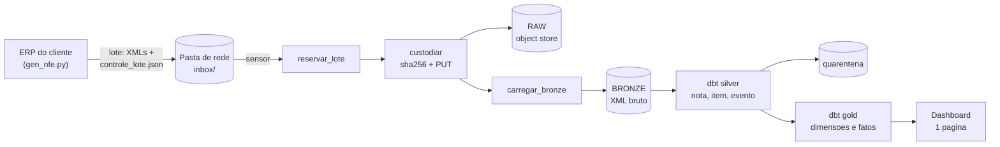

# Fluxo de ponta a ponta: as quatro linhas

O pipeline é planejado em **quatro linhas paralelas**, etapa por etapa. Cada coluna do mapa é uma etapa, e
cada linha responde a uma pergunta diferente sobre ela.

| Linha | Pergunta | Quando falha, o problema é... |
|---|---|---|
| **1. Carga** | o que entra, o que sai, onde grava? | da construção |
| **2. Observabilidade** | a carga rodou, chegou ao fim e não perdeu nada? | do **processo**: reprocessar, investigar a execução |
| **3. Qualidade** | o conteúdo é válido e os números fecham? | da **origem**: quarentena ou aviso ao fiscal |
| **4. Comprovação** | o usuário vê o número certo, e dá para provar? | de **confiança**: o painel não pode ser publicado |

Antes das linhas vem o objetivo ([01_escopo.md](01_escopo.md)), porque é ele que define o que medir. "Lote no
painel em 30 minutos" torna o frescor uma métrica de observabilidade. "Provar o XML daqui a cinco anos" torna
a integridade da custódia um controle permanente, e não um teste de implantação.

## 1. Linha de carga

Uma DAG, `dag_nfe_saida`, com um lote por execução. O lote é a unidade de entrega, de carga e de registro.

## 2. As quatro linhas por etapa

| | Origem (pasta de rede) | Raw (custódia) | Bronze | Silver | Gold | Dashboard |
|---|---|---|---|---|---|---|
| **1. Carga** | ERP entrega um lote por dia em `inbox/lote_AAAA-MM-DD/`: `procNFe`, `procEventoNFe` e `controle_lote.json` (totais + romaneio com sha256). A pasta só aparece quando o lote está completo | `reservar_lote` move o lote para `processando/`. `custodiar` calcula o sha256, grava no bucket versionado e registra em `custodia.documento` | `carregar_bronze` insere o XML bruto em `bronze.documento_xml`, 1 linha por arquivo, só INSERT | dbt com `XMLTABLE` e contrato: `nfe_nota`, `nfe_item`, `nfe_evento`, `nfe_situacao`. Reenvio: vale o arquivo mais recente | dbt: dimensões, `ft_nfe_item`, `ft_nfe_documento`, `ag_fiscal_mensal`. Cancelada fica fora dos totais; devolução entra com sinal negativo | Grafana, 1 página, lendo só a gold e as tabelas `ctrl` |
| **2. Observabilidade** *rodou e entregou tudo?* | Chegou lote? Idade do lote mais antigo na inbox. Arquivo de controle presente? | Chegou tudo? declarados no controle × arquivos na pasta × objetos no bucket. Depois: verificação de integridade (recalcula o hash × inventário) e teste de restauração | Ingeriu tudo? objetos custodiados = linhas na bronze. Duração e tentativas da task | Processou tudo? bronze = válidos + quarentena. Chaves sem nota = 0 | Fechou? silver = gold em quantidade. Lote `PROCESSADO`. Frescor: da emissão até disponível | Status da última carga e horas sem dado novo, no topo da página |
| **3. Qualidade** *o dado está correto?* | Verdade de referência: gabarito do gerador e o que o controle declara (quantidade, soma de `vNF` e sha256 por arquivo) | Nenhuma regra barra: o bruto é a evidência. Só identidade: mesmo hash (reenvio idêntico) × mesma chave com hash diferente (alerta) | Nenhuma regra de negócio | **Erro → quarentena:** XML malformado, chave ou DV inválidos, sem protocolo ou `cStat` ≠ 100, emitente fora do grupo, evento sem nota. **Aviso → `ctrl.dq`:** total ≠ soma dos itens, CST × cClassTrib, alíquota × vigência, CFOP × destino, buraco de numeração | Auditoria dos números: quantidade, soma de `vNF` e de cada tributo iguais na silver e na gold. Chaves órfãs. Cancelada fora do total | `ctrl.reconciliacao` da origem à gold, por lote. Gabarito: anomalias injetadas × detectadas |
| **4. Comprovação** *o que cada etapa manda para a página* | totais declarados pela origem | quantidade de documentos sob custódia e data da última verificação de integridade | — | contagem de quarentena e de avisos | fatos e agregados | **a página**: notas, valor, tributos, abertura por nota e por produto, com o selo de conferência |

## 3. Onde as linhas se tocam

**A quarentena serve às linhas 2 e 3.** A observabilidade usa a contagem: bronze = válidos + quarentena prova
que nada sumiu. A qualidade usa o motivo. Um lote com arquivos barrados pode terminar `PROCESSADO`: o pipeline
fez o que devia.

**A reconciliação serve às linhas 3 e 4.** A mesma tabela (`ctrl.reconciliacao`) que audita os números por
lote é o que o painel lê para mostrar o selo. O painel não recalcula a conferência, só a exibe.

**A custódia serve às linhas 1 e 2.** Gravar no object store é carga. Continuar provando que o arquivo não
mudou é observabilidade, e roda fora da DAG de carga, em agenda própria.

## 4. Erro, aviso e incompleto

Três situações diferentes, com três destinos:

| Situação | Exemplo | Destino | Quem age |
|---|---|---|---|
| **Erro de dado** | XML truncado, chave com DV inválido, emitente que não é do grupo | quarentena, com o motivo | origem (ERP) reenvia |
| **Aviso fiscal** | total de CBS diferente da soma dos itens | `ctrl.dq`; a nota segue para a gold | fiscal avalia |
| **Falha de processo** | lote com menos arquivos que o declarado, task que falhou | `ctrl.lote` = `INCOMPLETO` ou `ERRO` | TI reprocessa |

Regra que sustenta a separação: **execução verde não é carga saudável**. Quem informa a saúde é `ctrl.lote`,
não o estado da DAG.
